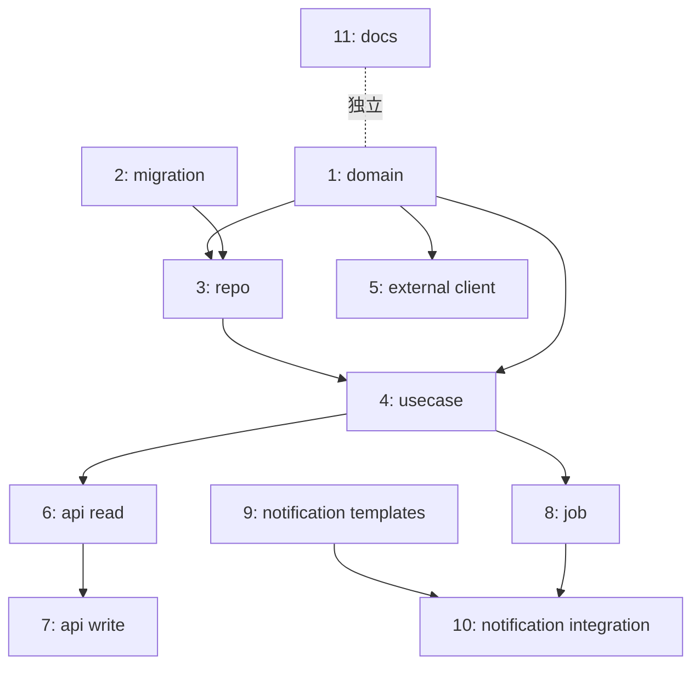

# SFAD Plan — 実装計画 / PR 分割

機能仕様（functional + threat + resilience）を入力に、**PR 分割計画** を出力するスキル。
「6000 行 PR を 1 個出して誰もレビューできない」状態を仕様段階で防ぐ。

## 何を防ぐか

このスキルは以下の事故を **仕様段階で** 防ぐ:

- 1 PR が大きすぎて人間も AI レビュアーも全部読めない
- マイグレーションの後付け増殖（0001_add_x → 0002_add_x → 0003_add_x）
- 「実装しながら気付いて足す」スコープクリープ
- 機能の縦切りができておらず、依存が複雑化する
- 認可テスト・失敗系テストが書かれずに済まされる
- レイヤー（domain / application / infra / api）が混ざる

## Invocation

```
/sfad plan [feature]
/sfad plan docs/specs/{feature}/
```

## 入力

- `docs/specs/{feature}/functional.md`
- `docs/specs/{feature}/threat.md`
- `docs/specs/{feature}/resilience.md`

## Execution Flow

### Step 1: 機能の構成要素を分解

機能を以下のレイヤーに分解する。

| レイヤー | 含むもの |
|---|---|
| **Domain** | 純粋関数、エンティティ、value object、ビジネスルール |
| **Application** | UseCase、サービスのオーケストレーション |
| **Infrastructure** | リポジトリ、外部 API クライアント、ストレージ |
| **API / Adapter** | FastAPI ルーター、リクエスト/レスポンス変換 |
| **Job / Scheduler** | バックグラウンドジョブ、cron |
| **Migration** | DB スキーマ変更 |
| **Frontend** | 画面、コンポーネント、フック |
| **Docs** | フロー図、運用ドキュメント |

各レイヤーで「このフェーズで作るもの」を列挙する。

### Step 2: PR 単位への分割

以下のルールで PR を切る:

#### 分割ルール
1. **1 PR = 1 つのテスト可能な単位** (純粋関数 + そのテスト、または 1 UseCase + テスト など)
2. **1 PR は 300〜500 行を目安**（diff 行数）
3. **1 PR は人間が 30 分で読み切れる量**
4. **依存があれば順番に積む**（stacked PR）
5. **ロールバック単位として独立**（1 PR をリバートしても他が壊れない）
6. **マイグレーションは最初の方の PR にまとめる**（後付け増殖を防ぐ）
7. **認可テスト・失敗系テストは write 系 PR に必ず含める**

#### 禁止パターン
- 1 PR で domain + application + infra + api + frontend 全部入り（縦串）
- マイグレーション 1 と 2 で同じテーブルを修正（最初に統合すべき）
- write 系 API を追加する PR で認可テストが無い
- ジョブを追加する PR で冪等性テストが無い

### Step 3: PR 分割表の作成

**この表の並びは「マージ順（依存順）」であり、テストを書く順ではない。**
内側（domain）から先にマージするのは #3 が #1 に依存するからで、各 PR の中では
impl.md のとおり外側から書く（受け入れテスト → 内側）。両者は別物なので混同しないこと。

```markdown
## Implementation Plan

### PR チェーン

| # | PR タイトル | 含むもの | 行数目安 | 依存 | テスト要件 |
|---|---|---|---|---|---|
| 1 | feat: add domain types and pure functions for X | `domain/X/`, value objects, pure functions, **unit tests** | 200 | なし | unit (純粋関数) |
| 2 | feat: add migration for X tables | alembic 1 本（テーブル + 制約 + index 全部入り） | 150 | なし | downgrade テスト |
| 3 | feat: add X repository (SQLAlchemy) | `infrastructure/X/repo.py`, **integration test** | 200 | #1, #2 | integration (実 DB) |
| 4 | feat: add X UseCase | `application/X/use_case.py`, **unit test (with fakes)** | 250 | #1, #3 | unit (Fake repo 注入) |
| 5 | feat: add X external service client (外部解析API) | `infrastructure/X/external_analysis_client.py`, protocol, **fake 実装**, **unit tests** | 200 | #1 | unit (success/failure/timeout/parse-fail) |
| 6 | feat: add X API endpoints (read) | `api/v1/X.py` GET 系 + **e2e test** + **auth test** | 200 | #4 | e2e + 認可 |
| 7 | feat: add X API endpoints (write) | POST/PUT/DELETE + **auth test** + **validation test** + **idempotency test** | 300 | #6 | e2e + 認可 + 冪等性 |
| 8 | feat: add X job (with idempotency) | `jobs/X.py` + scheduler 統合 + **idempotency test** + **error continuity test** | 300 | #4 | unit (Fake 注入) + idempotency |
| 9 | feat: add X notification templates | `templates/notification_templates.json` の追加分 + テンプレ検証テスト | 100 | なし | template existence test |
| 10 | feat: integrate X notification into existing flow | 既存ジョブに分岐追加 + **regression test** | 150 | #8, #9 | regression (既存フローが壊れない) |
| 11 | docs: add X flow documentation | `docs/specs/X/flow.md` (mermaid) | 200 | なし | なし |

合計: 11 PR / 約 2250 行（平均 ~200 行/PR）
```

### Step 4: 依存グラフの可視化



並行作業可能な PR を明示する（複数人で進める場合）。

### Step 5: スコープ境界の明示

```markdown
## このフェーズで実装すること（In Scope）
- ↑ PR 1〜11 の内容

## このフェーズで実装しないこと（Out of Scope）
- 一覧のキャッシュ（パフォーマンス改善）
- 解析結果の機械学習補正
- WebSocket でのリアルタイム更新
- 多言語化
- マルチテナント対応
- ユーザー画像 ACL の presigned URL 化（既存パターンに合わせて後続 PR）

これらは別 Plan として独立して扱う。
```

**ルール**:
- 「やらないこと」を明示しないとスコープクリープが発生する
- 「次フェーズで必須」は明記する（後で忘れない）

### Step 6: マイグレーション統合チェック

```markdown
## マイグレーション統合

このフェーズで追加するマイグレーション: **1 本のみ**

### 0001_add_X_support.py
- ENUM 型作成
- table 1 作成 + 全制約 + 全 index
- table 2 作成 + 全制約 + 全 index
- table 3 作成 + 全制約 + 全 index
- 既存 table への column 追加
- unique 制約: (col_a, col_b), (col_a, col_c)  ← 後付けにしない

**ルール**:
- 同フェーズで 2 本以上のマイグレーションを切らない（後付けの兆候）
- unique 制約は最初から入れる（resilience.md に基づく）
- index は最初から入れる（resilience.md の観測要件に基づく）
- downgrade テストを書く。**`MIGR-N` として functional.md の Test List に載せる**
  — plan.md は drift の検査対象外（腐ってよい文書）なので、ここに書いただけでは
  誰も実在を確認しない。Test List に載せて初めて COVERAGE GAP が効く
```

### Step 7: 各 PR の受け入れ基準

各 PR について以下を明示:

```markdown
## PR #N の受け入れ基準

- [ ] テスト全 Green
- [ ] lint / format / type check 通過
- [ ] 該当する spec の Test List 項目にチェック
- [ ] PR 本文に「何を変えた」「なぜ」「どうやって動くか」を記載
- [ ] PR 本文に既存機能への影響を記載
- [ ] 認可テスト / 失敗系テスト / 冪等性テストが該当するなら全て書かれている
- [ ] レビュアーが 30 分で読み切れる量
```

### Step 8: 出力の保存

`docs/specs/{feature}/plan.md` に保存。

## Output

```
Implementation Plan 完了

PR 分割: {N} 本
合計行数: 約 {M} 行
平均 1 PR: 約 {M/N} 行
最大 1 PR: {Max} 行（300〜500 目安、超過時は警告）

依存チェーン: {層の深さ}
並行作業可能: {並列数}

スコープ境界:
  In Scope: {N} 項目
  Out of Scope: {M} 項目（明示済み）

マイグレーション: {N} 本（1 本推奨）

各 PR の受け入れ基準: 全項目記載済み

保存先: docs/specs/{feature}/plan.md

次のステップ:
  /sfad test {feature}
  → PR #1 の domain 層から Red テスト生成を開始
```

## ゲート

- 1 PR が 1000 行を超える → 警告 + 分割再考
- マイグレーションが 2 本以上 → 警告 + 統合再考
- write 系 PR に認可テストが含まれていない → エラー停止
- ジョブ追加 PR に冪等性テストが含まれていない → エラー停止
- Out of Scope が空 → 警告（書き忘れの可能性）
- 依存グラフが循環している → エラー停止

このゲートを通らないと /sfad test に進めない。

## Plan モードとの統合

このスキルの出力（PR 分割表）は、Claude Code の **Plan モード** にそのまま渡せる。
各 PR ごとに Plan モードで実装計画を生成し、approve 後に /sfad test → /sfad impl へ進む。

```
/sfad plan {feature}
  ↓ plan.md 生成
  ↓ ユーザー approve
  ↓
PR #1 を実装する場合:
  Plan モード起動
  → plan.md の PR #1 項目を読み込み
  → 実装計画生成
  → ユーザー approve
  → /sfad test {feature} --pr 1
  → /sfad impl
```
